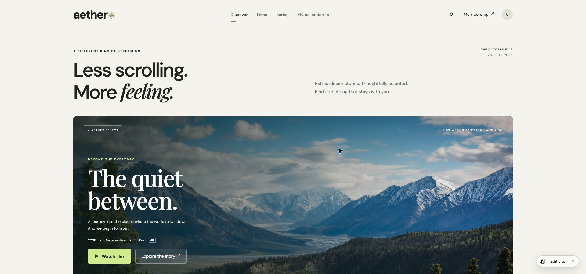
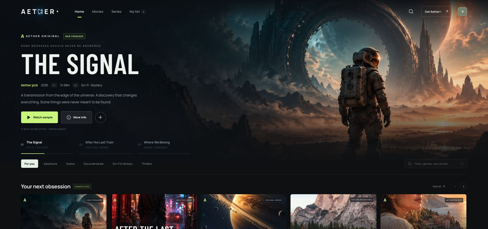
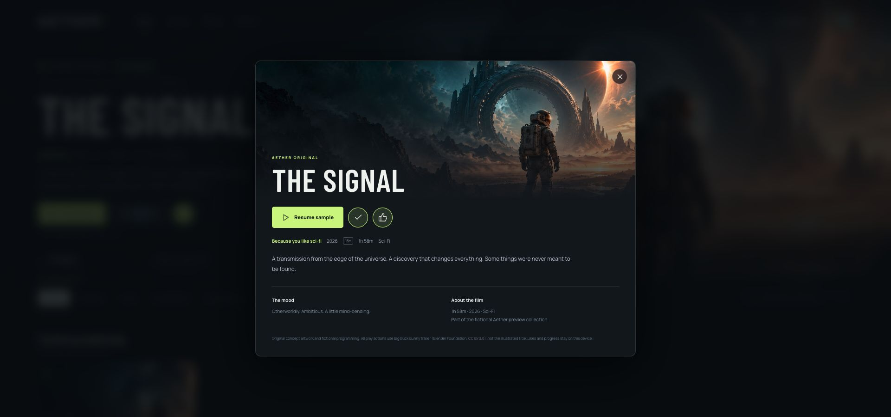
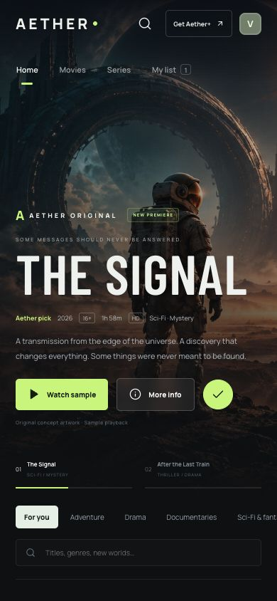
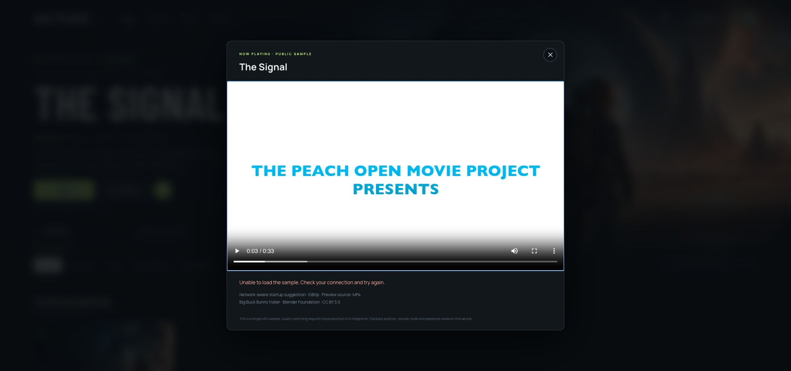
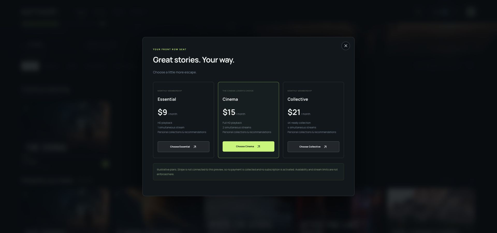

# Frontend redesign — October 21, 2026

The former interface placed a large marketing slogan above the feature and kept browsing below the first viewport. The new interface gives the first screen to a selectable film feature, followed by dense content shelves. This is a visual and interaction upgrade to the private prototype; it does not change the provisioning status of Spring Boot, billing or protected streaming.

## Captured flow and findings

1. **Original home — weak discovery hierarchy.** The screenshot shows extensive blank space and a promotional headline preceding the feature. Four-column landscape cards and an undifferentiated collection did not convey the breadth or character of a streaming service. This finding is based on the current-run screenshot, not a captured audit of Netflix/Prime/Disney.

   

2. **Redesigned home — improved, visually checked.** A full-bleed original science-fiction feature anchors the first viewport. A sticky nav, manual featured-title selector, genre strip, search, horizontal recommendations and portrait originals create direct routes into the catalog. Ten editorial choices have a numbered rail; the rank is editorial, not a fabricated popularity metric. Navigation, filters, search and view-all actions worked in browser checks.

   

3. **Title details — working.** Original artwork, synopsis, transparent recommendation reason, mood and film metadata accompany sample playback, likes and list controls. Native dialog semantics, focus outlines and pressed states provide a keyboard/screen-reader foundation; this is not a full accessibility certification.

   

4. **Mobile home — visually checked.** The layout was inspected at 390px and 360px widths with no horizontal page overflow. Hero art is reframed to preserve the astronaut, navigation becomes two rows, genre tabs and shelves scroll horizontally, and dialogs collapse appropriately. The tablet layout also fit at 768px.

   

5. **Sample playback — working with verified media.** The original sample source returned 403 and was repaired. The native player loaded and played the W3C-hosted Big Buck Bunny trailer, and reopening it restored saved time (~3.03 seconds). Continue watching appeared from actual sample progress. This proves preview behavior, not HLS/DRM or account synchronization.

   

6. **Membership and studio — working preview boundaries.** Three memberships render with clear unavailable-checkout messaging; no fake payment or entitlement is created. The studio form saves local drafts and discloses that production publishing needs the Spring Boot admin service.

   

## Artwork and code

Five original assets were generated with the built-in ImageGen tool: `dist/assets/signal-hero.jpg`, `neon-poster.jpg`, `coast-poster.jpg`, `orbit-poster.jpg`, and `wild-poster.jpg`. Each file is optimized JPEG; image-generation prompts are in [ARTWORK.md](ARTWORK.md). Additional nature imagery remains remotely loaded from Unsplash. Icons use the bundled Lucide library and included license. Film metadata is fictional.

Implementation: `dist/index.html`, `style.css`, `catalog.js`, `app.js`. No frontend framework or backend technology change was needed. The Spring Boot backend and its deployment status are unchanged.

## Remaining limits

The private frontend still uses device-local state. Live identity, account sync, Stripe, signed HLS delivery and publishing need real integration. No claim is made that a visual redesign confers production readiness or million-viewer capacity. A full contrast, screen-reader and assistive-technology audit remains required. The screenshots demonstrate the actual application states captured in this run.
