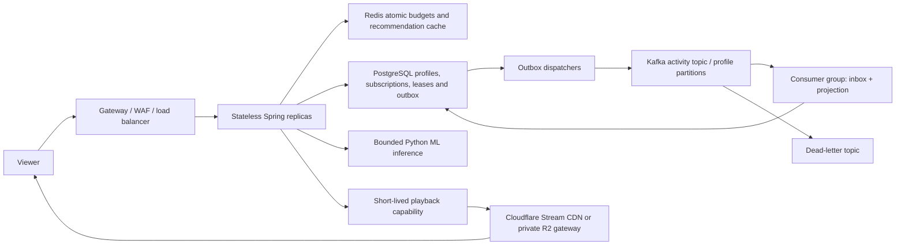

# Kafka, admission control and production scaling

This release implements the controls below. The free Render deployment remains a small demonstration; it does not run a Kafka cluster or prove million-viewer capacity. Kafka is exercised in the local Compose overlay. Production must provide managed Kafka/PostgreSQL/Redis, capacity, secrets, TLS/ACLs and operational ownership before enabling that topology.



## Playback and subscriptions

`PlaybackSessions.acquire` locks the account row and atomically checks active/trialing entitlement and its server-owned stream limit: Essential 1, Cinema 2, Collective 4. Retries use a stable tab client UUID. A second start for a different title in the same active tab is rejected until release. Leases expire in 120 seconds; the player heartbeats every 40 seconds with monotonic sequence and progress/sound state. Expired, revoked, non-owned or downgraded sessions cannot keep renewing. Duplicate/older heartbeat progress is ignored. Leaving the player releases its lease; a crashed browser eventually expires.

The CDN capability expires with its lease. An already issued token remains usable until expiry, and buffered media can continue briefly after a revocation; this is not instantaneous DRM or a guarantee that no shared token can ever be replayed. The server limits authorized leases, not physical people or decoded pixels. Large providers add DRM/license sessions and additional device/abuse controls.

Cloudflare Stream supports optional local RSA signing (`CF_SIGNING_KEY_ID`, base64 PEM `CF_SIGNING_PRIVATE_KEY`), avoiding a provider API request for every heartbeat. API-based signing remains a low-volume fallback. **Paid Stream is off unless `PAID_MEDIA_ENABLED=true` is deliberately configured.** R2 capabilities use the separate budget-enforcing gateway described in R2-BUDGETS.md.

Checkout uses persisted `CheckoutIntents` before Stripe IO, server price IDs and Stripe idempotency keys. Browser refreshes reuse the same unresolved intent. Dynamic expiry arguments are omitted so retries have identical Stripe parameters. After 23 hours an unresolved creation requires operator reconciliation before Stripe's idempotency window can expire. An expired previous session is checked before another purchase is allowed; a completed session awaiting reconciliation is blocked. Checkout cancellation can leave an existing hosted session open until expiry; changing plans while a checkout is pending is intentionally blocked. Webhooks verify raw-body signatures, deduplicate event IDs and retrieve current subscription state before persisting the price-derived plan/stream limit. Provider test-mode end-to-end verification still requires real Stripe configuration.

## Distributed admission and backpressure

With `ADMISSION_ENABLED=true`, a Redis Lua token bucket uses Redis TIME and SHA-256 subject keys, shared by replicas. Identity requests use ingress remote IP; authenticated calls use JWT subject. Budgets per minute: identity 30, recommendations 30, playback control 180, general API 240. Redis failures fail closed with 503 for protected API traffic; static assets and health remain accessible. Signed Stripe webhooks are exempt from the IP budget so shared provider addresses do not block reconciliation, but still use the local bulkhead and signature validation.

A non-queuing semaphore bounds in-flight API work; overflow returns 503 and Retry-After. Rate rejection returns 429 and Retry-After. Tomcat threads, accept queue, connections, JDBC pool and inference concurrency are bounded independently. Recommendation misses admit at most four inference requests per JVM; same-key local coalescing and editorial fallback avoid unbounded waits. Redis is optional for recommendation caching but mandatory when distributed admission is enabled. A trusted external ingress/WAF must rate-limit unauthenticated JWT failures before expensive authentication. Never trust arbitrary X-Forwarded-For: configure trusted proxies explicitly; the application defaults to the actual remote address.

## Kafka data path

`infra/compose.kafka.yml` overlays the disposable local stack with a real Apache Kafka broker. Use:

```
docker compose -f infra/compose.stack.yml -f infra/compose.kafka.yml up --build
```

Local Kafka uses one broker/replication factor 1 and PLAINTEXT inside a private Docker network, strictly for tests. Production defaults to **12 partitions, replication factor 3, min.insync.replicas 2, acks=all and producer idempotence**. Use three failure domains, durable broker disks, TLS/SASL and producer/consumer/admin ACLs. Configure `KAFKA_SECURITY_PROTOCOL`, standard Spring Kafka SASL settings, bootstrap servers and trusted certificates through the deployment secret manager. No Kafka broker or port is publicly exposed by Compose.

API replicas set `KAFKA_ENABLED=true`, publisher/consumer flags false. Dedicated worker replicas set `KAFKA_PUBLISHER_ENABLED=true` and `KAFKA_CONSUMER_ENABLED=true`; PG fallback workers are automatically disabled in Kafka mode. Dispatch and consumption can be split further using those flags. Consumer group `aether-activity-v1` processes three partitions concurrently per worker. Scaling consumers beyond 12 active consumers for this topic does not increase partition parallelism.

Progress/reaction writes and outbox insertion share one PostgreSQL transaction. Pending snapshot jobs coalesce by profile/title/kind, and a profile with 1,000 unprocessed jobs is rejected transactionally instead of accumulating unlimited work. Dispatchers use SKIP LOCKED claims, commit the lease before broker IO, await acknowledgement, then mark publication. Expired claims retry after process death. Broker failure keeps durable work and retries with delay. No Kafka/Redis dual write is used in the viewer request.

The profile UUID is the partition key. Retries/parallel dispatch can reorder event IDs, so consumers apply idempotent snapshot projections and monotonic last-event IDs rather than assuming strict global order. A PostgreSQL inbox ID, projection and job completion commit atomically; offsets commit after listener return. A crash between DB commit and offset commit replays safely. This is **at-least-once delivery with idempotent DB effects**, not a distributed exactly-once claim.

The explicit poison-record target is `aether.activity.v1.DLT`, preserving the source partition. Three delayed retries precede DLT publishing; a failed DLT send must fail recovery instead of discarding the source offset. Main topic retention is 7 days, DLT 14 days. Completed outbox rows retain 30 days; inbox entries retain at least 45 days and are removed only after the corresponding outbox row is gone. Maintenance deletes at most 5,000 rows per statement. Dead/unresolved jobs are not automatically discarded. Reconcile and replay DLT records deliberately; do not bulk-replay unrelated historical schemas.

## Database and recommendation changes

The catalog uses composite keyset pagination and a partial index. Real series metadata and uniquely numbered episodes are separate records/bundles. Playback catalog pages do not send video bytes. Profile history uses bounded recent playback/reaction slices via indexes instead of joining every published title. Episode taste maps to its parent series. Revision triggers invalidate cached recommendations immediately on writes/publication. A warm cache hit occurs before catalog/history payload assembly, while server-owned LLM policy is still read on every request. LLM remains disabled unless an administrator explicitly enables it.

In the local benchmark with 100,000 synthetic titles and 100 profile history rows, the previous join took median 27.882 ms, the bounded query 0.704 ms across three runs. These TEMP-table timings isolate a query change, not production latency. They do not model storage replication, a million accounts, concurrent writes or cross-region latency.

## Verification and remaining production gates

The staged local load test uses two API replicas, Redis, PostgreSQL, Python and real Kafka, ramps to a configured 50 virtual users, and sends catalog, recommendation and progress requests. One recorded run completed 1,454 requests with zero HTTP failures and 53.72 ms p95. The deliberate overload run returns a mixture of admitted requests, 429 and 503; its high request count represents rejection handling, not successful business throughput. Consult accompanying logs for status counts.

Broker-stop checks preserve accepted writes and drain after recovery. Redis-stop checks fail closed with health still available. Python-stop checks return editorial fallback. Concurrent lease tests admit only the configured limit across eight competing starts. Tests include cookie/JWT authorization, Stripe timeout intent reuse and quota-boundary/cycle cases. A final real-broker check delivered `invalid-json-fixture-v2` to `aether.activity.v1.DLT`; duplicate delivery preserved the existing projection count.

Before production, validate managed-broker quorum/zone loss, PostgreSQL failover and restore, Redis failover, long-duration real media playback, GB transfer recovery, billing webhooks, CDN/DRM/license behavior, certificate/key rotation, quotas, and operator alerts under progressively measured load. Free R2 guardrails deliberately stop media requests before free allowances and cannot simultaneously serve a million viewers. Do not lift them silently or advertise capacity from these local tests.
